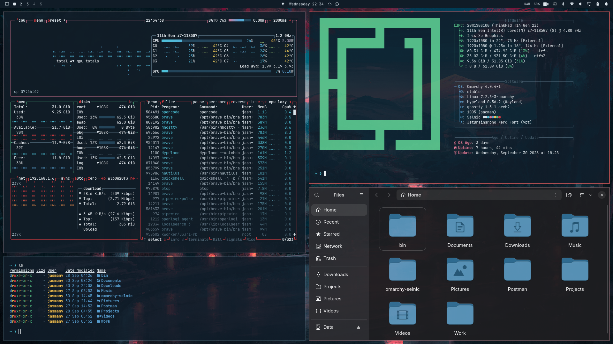

# SelNic

Tema oscuro para [Omarchy](https://omarchy.org): azul marino profundo, carmesí
reservado para el foco y un prompt de Starship a juego.



## Instalación

```sh
omarchy theme install https://github.com/Darkjasmany/omarchy-selnic-theme.git
~/.config/omarchy/themes/selnic/install.sh
```

El segundo paso genera el tema de iconos `SelNic-folders` y aplica el logo de
Plymouth. Si faltan dependencias, el tema usa `Yaru-blue` y sigue funcionando.

### Requisitos

- Omarchy con la sesión gráfica iniciada.
- `magick` (ImageMagick) para los iconos. Sin él, se usa `Yaru-blue`.
- `Yaru-blue` instalado, que viene con Omarchy.
- `sudo` para la pantalla de desbloqueo.

## Qué incluye

```text
omarchy-selnic-theme/
├── colors.toml           paleta del tema
├── backgrounds/          4 fondos
├── icons.theme           SelNic-folders
├── preview.png           miniatura del selector de temas
├── preview-unlock.png    miniatura de la pantalla de bloqueo
├── unlock.png            logo de Plymouth
├── starship.toml         prompt del tema
├── tools/
│   └── generar-carpetas.sh
├── install.sh
└── LICENSE
```

Omarchy genera en cada cambio de tema los archivos derivados de `colors.toml`
(`shell.toml`, `hyprland.lua`, configuraciones de terminal, `btop.theme`,
`vscode-theme.json`, etc.). Por eso no se guardan aquí: una copia congelada se
desincronizaría de la paleta.

## Paleta

| Papel | Color |
|---|---|
| Fondo | `#101C27` |
| Fondo oscuro | `#0B1620` |
| Texto | `#DCE5EC` |
| Acento y borde activo | `#E33E43` |
| Azul | `#5AA3D6` |
| Cian | `#4FC5DB` |
| Verde | `#57C08A` |
| Amarillo | `#F5C451` |
| Carpetas | `#5A96BA` |

El carmesí se reserva para el borde de la ventana enfocada, el indicador del
panel abierto y los errores del prompt. Las carpetas usan un azul cercano al
fondo para no competir con ese acento.

## Carpetas

`SelNic-folders` solo recolorea la rejilla de Nautilus. El lateral se deja
intacto: GTK pinta los glifos simbólicos con el color de primer plano y hereda
el blanco de `Yaru-blue`. El resto de iconos también se hereda, así que las
actualizaciones de Yaru llegan solas.

```sh
# regenerar desde la copia instalada del tema
~/.config/omarchy/themes/selnic/tools/generar-carpetas.sh
gsettings set org.gnome.desktop.interface icon-theme 'SelNic-folders'
```

El color se puede cambiar sin editar el script:

```sh
SELNIC_CARPETAS_COLOR='#5A96BA' ./tools/generar-carpetas.sh
```

Para volver al tema de iconos original:

```sh
gsettings set org.gnome.desktop.interface icon-theme 'Yaru-blue'
```

## Pantalla de desbloqueo

`install.sh` llama a `omarchy-plymouth-set-by-theme selnic`, que toma
`background`, `foreground` y `unlock.png` del tema. Plymouth se dibuja al
arrancar, así que el cambio se ve al reiniciar.

## Starship

`starship.toml` incluye la paleta SelNic y los símbolos del preset oficial de
Nerd Font. Para usarlo:

```sh
ln -sf ~/.local/state/omarchy/current/theme/starship.toml ~/.config/starship.toml
```

Omarchy puede hacer ese enlace automáticamente con un hook `theme-set.d`.

## Licencia

MIT. Consulta [LICENSE](LICENSE).
